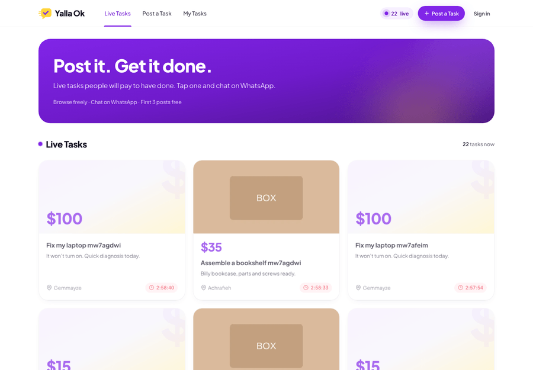
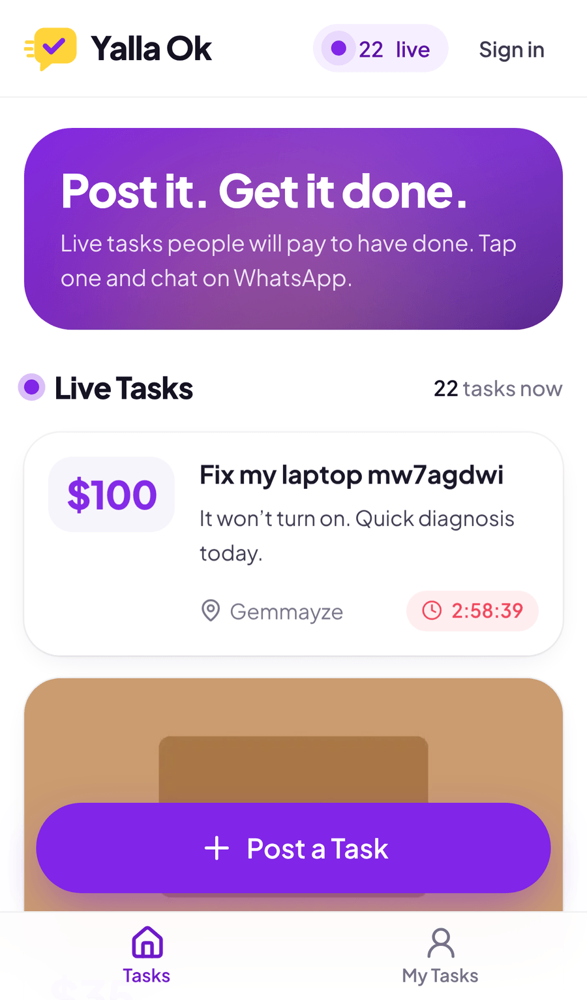
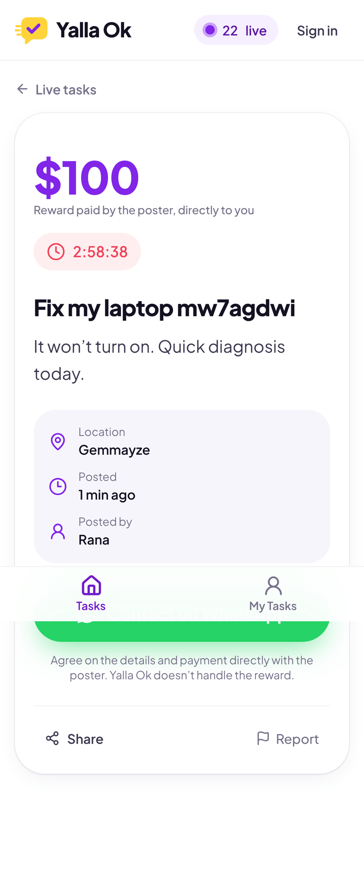
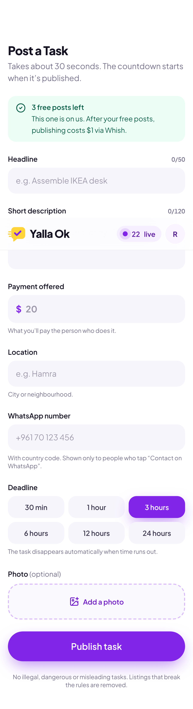
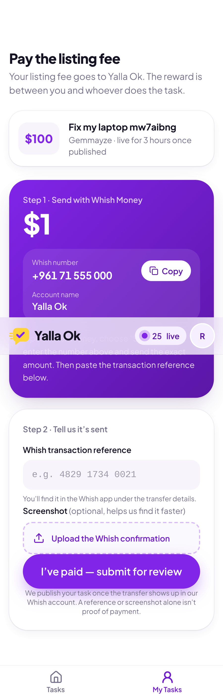
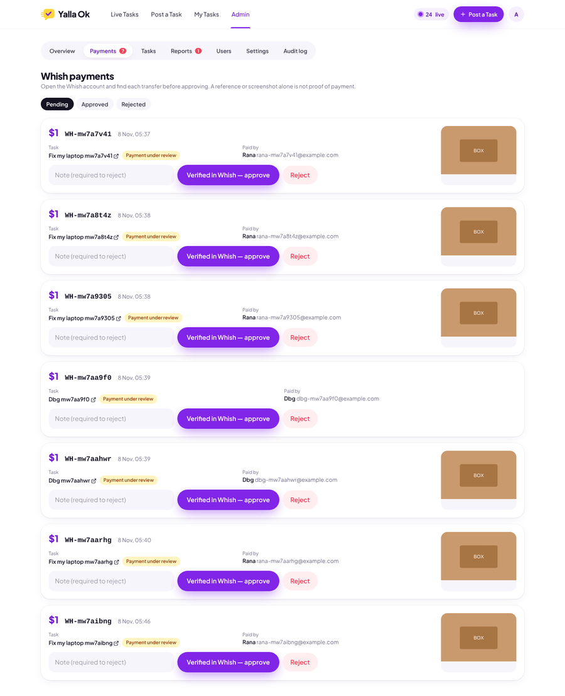

# Yalla Ok

**Post it. Get it done.** A real-time marketplace for small tasks. People post what they need done, the reward and a deadline. Others browse the live feed and contact the poster on WhatsApp.

| Live feed (desktop) | Phone | Task |
| --- | --- | --- |
|  |  |  |
| **Post a task** | **Pay listing fee (Whish)** | **Admin: Whish payments** |
|  |  |  |

## Stack

Next.js 15 (App Router, Server Actions) · TypeScript · Tailwind CSS · Supabase (Postgres, Auth, Storage, Realtime) · `pg_cron` · `sharp` · installable PWA.

## Run it locally

```bash
cd yalla-ok
npm install
npx supabase start            # local Supabase in Docker: applies the migration and the demo seed
cp .env.example .env.local    # paste the API URL, anon key and service-role key that `supabase start` printed
npm run dev                   # http://localhost:3000
```

**Make yourself admin.** Sign up in the app, then run:

```sql
update public.profiles set role = 'admin' where email = 'you@example.com';
```

Admin roles are only changed in SQL. No screen or API can grant them.

## Deploy to a hosted Supabase project

1. Create the project. Then either run `npx supabase link` and `npx supabase db push`, or paste `supabase/migrations/20261108000000_init.sql` into the SQL editor.
   - The migration creates the storage buckets and adds `feed_events` to Realtime.
   - It also schedules expiry every minute with `pg_cron`. Enable the `pg_cron` extension first (Database → Extensions).
2. Optionally run `supabase/seed.sql` to load demo tasks. Every demo task is marked `is_demo` and shows a **Demo** badge. Remove them with `delete from tasks where is_demo;`.
3. In **Authentication → URL configuration**, set the site URL and add `https://your-domain/auth/callback` as a redirect URL.
4. **Google sign-in:** enable the Google provider in Supabase, then set `NEXT_PUBLIC_GOOGLE_AUTH=true`.
5. Deploy the Next.js app (Vercel or any Node host) with the variables from `.env.example`.
6. Set the real Whish number, the fee and the instructions in **Admin → Settings**.

## How it works

| Rule | Where |
| --- | --- |
| The browser only reads, through Row Level Security. Every write that matters goes through `SECURITY DEFINER` functions that check `auth.uid()` and run in one transaction. Direct `insert`/`update`/`delete` is revoked. | `supabase/migrations/…_init.sql` |
| The first 3 posts are free (configurable, with per-user adjustments). Each one uses a row in `free_post_usage`, unique per `(user_id, slot)`. Deleting a task never gives a slot back, and a double-submit is stopped by a per-form `client_token`. | `create_task()` |
| Paid post: **draft** → user submits a Whish reference and an optional screenshot → **pending payment** → an admin verifies it in Whish and approves → **active**. The countdown starts at approval. | `submit_payment()`, `admin_approve_payment()` |
| A Whish reference can pay for one listing only (`verified_payments.reference_normalized` is unique). Duplicate references are flagged in the admin view. Admins can't approve their own payment. Every decision goes to `admin_audit_logs`. | same |
| The task reward (what the worker gets) and the listing fee (Yalla Ok's revenue) are separate columns. Revenue counts only `verified_payments`. | `tasks.reward_cents` vs `tasks.fee_cents` |
| WhatsApp numbers live in `task_contacts`, which the public can't read. They leave the server only through the `/t/[id]/contact` redirect: `wa.me` on phones, WhatsApp Web on desktop, with the prefilled message. Demo tasks never redirect. | `src/app/t/[id]/contact/route.ts` |
| Expiry uses server time. The feed query hides past-deadline tasks, `pg_cron` marks them expired every minute, and countdowns use the server clock. `GET /api/cron/expire` is a backup for external schedulers. | `expire_tasks()` |
| Live feed: triggers write `published` / `updated` / `removed` rows to `feed_events`, and clients subscribe with Supabase Realtime. On reconnect, tab focus, or every 60 s, the feed reloads in full. | `src/components/live-feed.tsx` |
| Abuse protection: per-user hourly and daily rate limits, duplicate-listing detection, keyword/link moderation plus an admin blocked-word list (flagged tasks wait for approval), and reports. Three distinct reporters pull a task off the feed. Uploads are decoded and re-encoded with `sharp` (EXIF/GPS stripped, size-limited). | `create_task()`, `report_task()`, `src/lib/images.ts` |

## Tests

```bash
npm test          # unit tests (formatting, WhatsApp links, validation)
npm run test:db   # 66 business-rule checks against a throwaway PostgreSQL (needs initdb/pg_ctl/psql)
# full browser run against `supabase start` + `npm run build && npm start`:
node e2e/full-flow.mjs
```

The end-to-end script (Playwright) covers:

- signing up
- three free posts, then the $1 Whish flow
- realtime arrival and removal in a second browser
- WhatsApp links for phone and desktop
- duplicate refusal
- marking a task taken
- admin approval and settings
- reports
- countdown expiry
